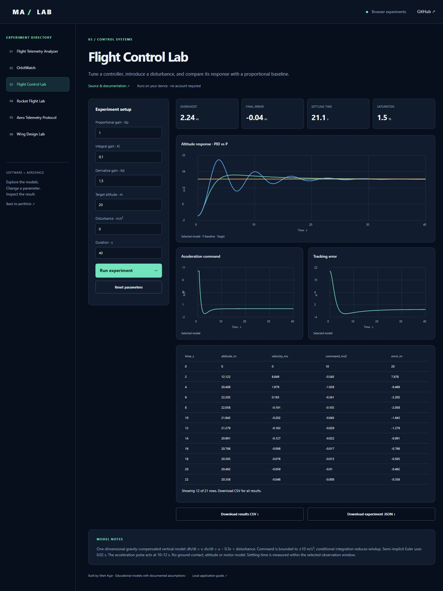

# Flight Control Lab

[Live browser demo](https://mertacar-git.github.io/flight-control-lab/) · [Portfolio laboratory](https://mertacar-git.github.io/portfolio/lab/index.html?project=flight-control-lab)

<details>
<summary>Actual application screenshot</summary>



</details>

[Short demo video](docs/demo.mp4) — a timed walkthrough of actual default and changed-parameter screenshots.

## Browser and local editions

The public browser demo runs JavaScript models on-device. The local application uses Python and Streamlit. JavaScript numerical/protocol outputs are checked against committed Python reference fixtures. Satellite.js 6.0.1 is bundled with its license; no runtime CDN is required. Uploaded CSV data is processed locally in the browser.

Browser orbit crossings use sampling and bisection, with sampled culmination times; local Skyfield uses its event search. Browser rocket inputs use constant thrust; local Python also supports uploaded thrust curves. Browser wing coefficients are fixed to CD0=0.025 and CLmax=1.2; local Python exposes these and a span sweep. Browser telemetry has CSV/JSON analysis; local Python additionally groups alert intervals.

```sh
node --test docs/models.test.cjs
```

Serve `docs/` with any static server to run the browser edition locally. Example: `python -m http.server 8000 --directory docs`. Open http://localhost:8000.


Interactively tune a PID controller for a simplified vertical-motion model, apply a disturbance and export the simulation.

## Features

- Balanced PID, proportional-only and damped-PD presets plus custom gains.
- Adjustable target altitude, duration and acceleration disturbance.
- Side-by-side plot comparison with a proportional controller.
- Altitude, velocity, acceleration command and tracking-error plots.
- Overshoot, finite-window settling time, 90% rise time, integral absolute error and saturation metrics.
- CSV time-series and JSON experiment exports.

## Example workflow

Compare **Balanced PID** against its P baseline. Introduce a 3 m/s² disturbance and increase duration to 80 seconds to inspect recovery. Switch to **Custom** to vary the gains. Export the experiment parameters so another person can reproduce it.

The model permits negative altitude and has no terrain/ground constraint. The disturbance is an acceleration pulse, not a full atmospheric model. The command is relative to gravity-compensated hover, and is not motor thrust. A finite observation window cannot prove future stability. The tests compare two integration timesteps and check bounded actuation, equilibrium and disturbance recovery.

## Quick start

Python 3.12 recommended. Run commands inside this repository.

```sh
python -m venv .venv
# Windows:
.venv\Scripts\activate
# macOS/Linux: source .venv/bin/activate
python -m pip install -r requirements.txt
python -m streamlit run app.py
```

## Validation

```sh
python -m unittest discover -v
```

## Model and limitations

Model: dh/dt = v; dv/dt = u - 0.3v + disturbance. The acceleration command is bounded to ±10 m/s² and interpreted relative to gravity-compensated hover. Derivative feedback uses measured velocity; conditional integration limits windup. Integration is semi-implicit Euler at 0.02 seconds. Settling time uses a 2% target band over the finite simulation window. This is an educational one-dimensional model, not aircraft flight software.

## Repository structure

- `core.py`: numerical/data processing functions
- `app.py`: interactive Streamlit interface
- `test_core.py`: checks for model behavior and invalid input

## Development

Built with AI assistance. Model assumptions and validation are documented so the implementation can be reviewed and extended.

## Checks and license

GitHub Actions runs core and Streamlit interaction tests on every push and pull request. The UI tests cover offline operation and primary controls. External data-service availability is not guaranteed by offline tests. MIT licensed; see `LICENSE`.
